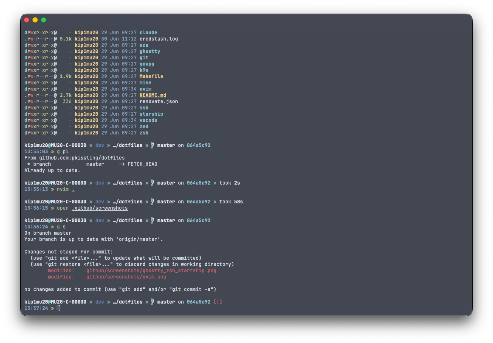
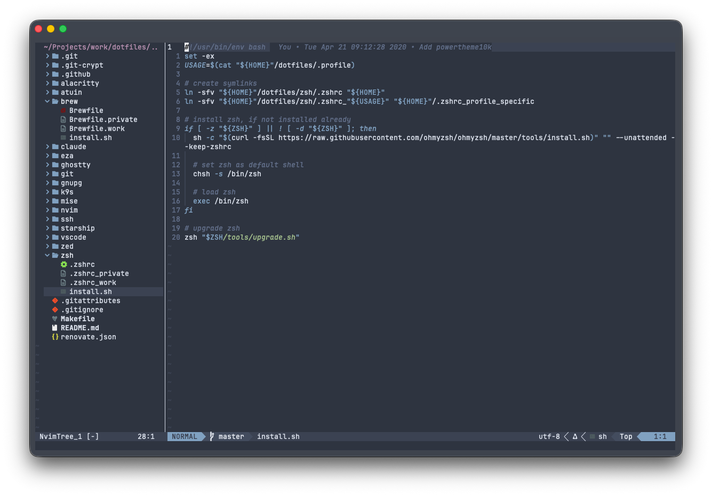

# dotfiles

 

## 🚀 Overview

Welcome to my dotfiles repository! This collection represents my curated development environment setup enabling me to work efficiently across various projects and technologies. The configurations included in this repository are tailored to my personal preferences and workflows, but feel free to use them as a starting point for your own setup.

## 🛠️ Tools & Configurations

Below is a comprehensive overview of the tools and their configurations included in this repository:

```bash
$ git clone git@github.com:pkissling/dotfiles.git
$ tree dotfiles
.
├── atuin
│   └── # https://atuin.sh - Powerful shell history manager
├── claude
│   └── # https://claude.ai - AI-powered coding agent by Anthropic
├── codex
│   └── # https://openai.com/codex - AI-powered coding agent by OpenAI
├── eza
│   └── # https://github.com/ogham/exa - Modern replacement for ls
├── ghostty
│   └── # https://ghostty.org - Modern terminal emulator
├── git
│   └── # https://git-scm.com/ - Version control system
├── gnupg
│   └── # https://gnupg.org - Encryption and signing tools
├── hunk
│   └── # https://github.com/modem-dev/hunk - Terminal diff viewer for code review
├── mise
│   └── # https://mise.jdx.dev - Runtime version manager
├── nix
│   └── # https://github.com/nix-darwin/nix-darwin - Declarative macOS packages, apps and settings
├── nvim
│   └── # https://neovim.io - Modern Vim editor
├── ssh
│   └── # - Secure shell configuration
├── starship
│   └── # https://starship.rs - Minimal, fast shell prompt
├── vscode
│   └── # https://code.visualstudio.com - Code editor
├── zed
│   └── # https://zed.dev - Modern code editor
└── zsh
    └── # https://ohmyz.sh - Shell environment
```

Packages, Homebrew casks, Mac App Store apps, macOS defaults and all config symlinks are declared in [`flake.nix`](flake.nix) and [`nix/`](nix), with one configuration per profile (`private`, `work`). Steps that can't be declarative (fetching keys from 1Password, updating plugins and runtimes) live in the remaining `install.sh` scripts.

## 🖼️ Visual Tour

### Terminal Environment

A terminal setup featuring Ghostty, zsh, and Starship prompt,



### Neovim Configuration



## 🚀 Quick Start

Install [Determinate Nix](https://docs.determinate.systems/), then run:

```bash
make
```

`make switch` only applies the Nix configuration; `make <tool>` runs a single tool's `install.sh` after it.
